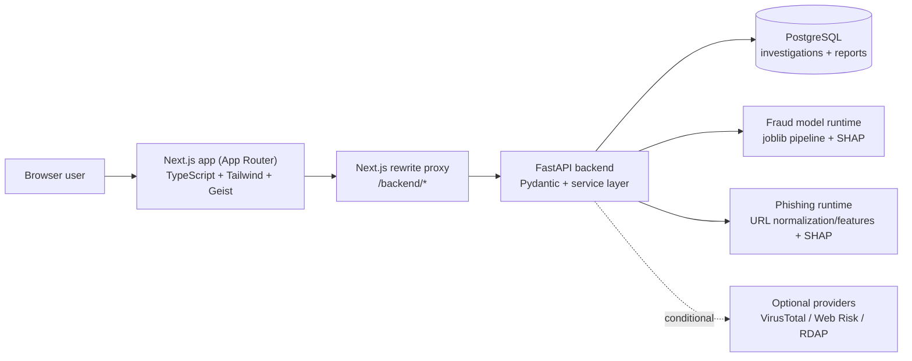
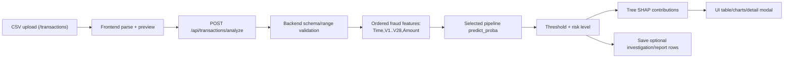
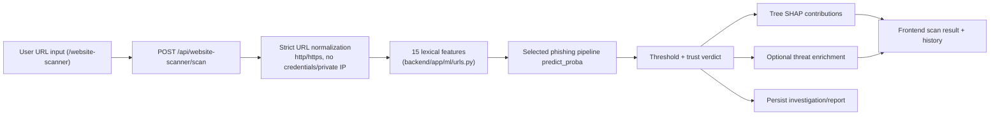
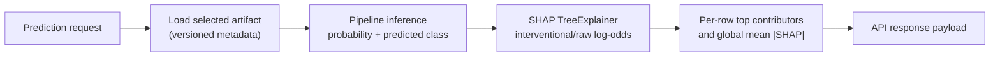
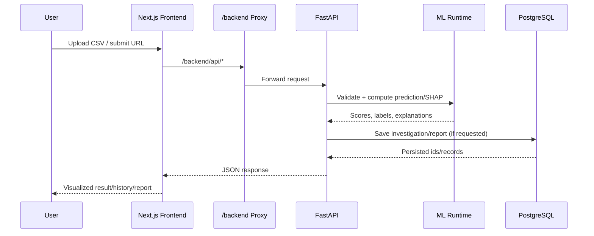

# ExplainPay architecture and workflows (implemented)

This document reflects the repository state and generated ML artifacts in
`reports/ml_analysis/`.

## 1) Overall system architecture

## 2) Transaction fraud detection pipeline

## 3) Website trust scanning pipeline

## 4) ML training pipeline

```mermaid
flowchart LR
    Raw["Raw CSVs\ntransactions/creditcard.csv\nwebsites/phishing_features.csv"]
    Prepare["Task-specific preparation\ncleaning + dedupe + feature schema"]
    Split["Stratified 60/20/20 split\nseed=42"]
    Scale["StandardScaler fit(train)"]
    Train["Train LR + XGBoost candidates"]
    Select["Select by validation AP\nthreshold by validation F1"]
    Persist["Persist selected artifact\n+ metrics JSON + background sample"]
    Analyze["Offline audit exports\nreports/ml_analysis/analyze.py"]

    Raw --> Prepare --> Split --> Scale --> Train --> Select --> Persist --> Analyze
```

## 5) Prediction and explainability workflow

## 6) Frontend-backend-ML service communication

## Planned vs implemented

- **Implemented:** all components shown above, including local selected model
  artifacts and SHAP payloads.
- **Planned/optional only:** live threat-provider enrichment unless credentials
  are configured; broader unseen-domain/temporal evaluation experiments.
